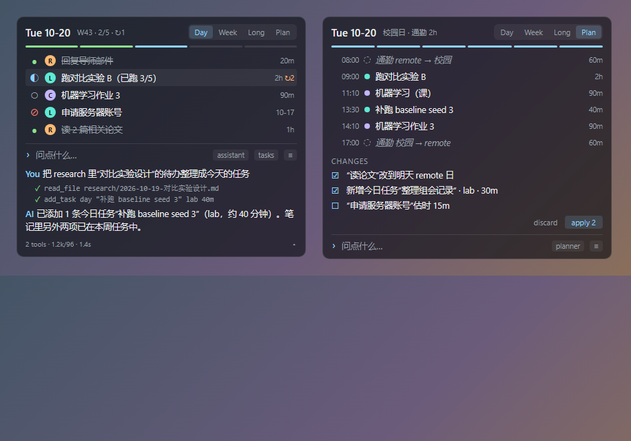

# ToDo 桌面任务管理（Rainmeter + DeepSeek）

一个放在 Windows 桌面上的个人任务管理工具：Rainmeter 皮肤负责显示和交互，`todo.exe`（C++20）负责所有读写，任务、计划和对话都保存在一个独立的 git 仓库里，每次修改一个提交。AI 部分使用 DeepSeek API：可以对话、按日 / 周生成和调整计划，桌面上还有一个会动的鲸鱼娘桌宠，可以陪你轻量聊天和帮忙搜索。

<p>
  
  
</p>

## 功能

- **任务**：日 / 周 / 长期三级任务，状态（todo / doing / done / blocked / dropped）、地点（lab / class / remote）、预估时间、备注；未完成的日任务每天自动顺延。
- **计划**：Plan 标签页显示当天或本周的时间线；`re-plan` 让模型根据任务、个人日程（`profile/`）和对话生成计划，改动逐条确认后再应用。
- **对话**：底部提问栏与 DeepSeek 对话，可按技能（assistant / planner / replan / research）使用读写任务、读写笔记、提出计划等工具；写文件前弹窗确认。
- **桌宠**：分层动画（眨眼、头发 / 尾巴 / 耳鳍摆动、拖动时甩动、眼睛跟随鼠标），ToDo 打开时看本子写字，空闲时睡觉（CPU 降到接近关闭时的水平）。
- **桌宠对话气泡**：点桌宠的尾巴或耳鳍打开，用于闲聊、查任务和笔记、网页搜索（DeepSeek 搜索接口）。它只有只读工具，不能修改任务、文件或计划。
- 三套界面风格（A / B / C），输入框跟随当前风格。所有时间使用系统时区。

## 环境要求

| 组件 | 说明 |
|---|---|
| Windows 10 / 11（x64） | 输入框的圆角和描边需要 Windows 11 |
| [Rainmeter](https://www.rainmeter.net/) 4.5 或更新版本 | 开发时使用 4.5.28；自带本项目用到的 RunCommand 插件 |
| Visual Studio 2022（"使用 C++ 的桌面开发"，MSVC v143） | 构建 `todo.exe` 和两个 Rainmeter 插件 |
| CMake 3.20+ | |
| Git | `todo.exe` 调用 `git` 管理内容仓库，需要在 PATH 中 |
| DeepSeek API key | 在 [DeepSeek 开放平台](https://platform.deepseek.com/) 申请；对话、计划、网页搜索都需要 |
| Python 3（可选） | 只有修改 `Main.ini` 布局（`scripts/gen_main_ini.py`）或重新导出桌宠素材（需要 Pillow、numpy）时才需要 |

### 安装 Rainmeter

1. 打开 <https://www.rainmeter.net/>，点击 **Download** 下载最新的正式版安装程序（`Rainmeter-x.y.z.exe`）。
2. 运行安装程序，选择 **Standard installation**，安装位置保持默认的 `C:\Program Files\Rainmeter`（本项目的安装脚本按这个路径调用 `Rainmeter.exe`）。
3. 安装完成后启动 Rainmeter，任务栏通知区域会出现 Rainmeter 图标；右键图标 → **Manage** 可以查看和管理皮肤。默认会加载自带的示例皮肤，可以在 Manage 中卸载（Unload）它们。
4. Rainmeter 的皮肤目录在 `Rainmeter.ini` 的 `SkinPath` 中（通常是 `文档\Rainmeter\Skins\`），安装脚本会自动读取，不需要手动复制。

## 构建

```bat
git clone https://github.com/luo-jingw/wallpaper.git ToDo
cd ToDo
cmake -S . -B build -G "Visual Studio 17 2022" -A x64
cmake --build build --config Release
```

产物在 `build\Release\`：`todo.exe`、Rainmeter 插件 `CursorPos.dll`（光标位置与高精度时钟）和 `DesktopState.dll`（ToDo 窗口位置、空闲时间、全屏检测），以及几个开发用的 probe。

## 配置

1. **内容仓库**：`todo.ini` 中的 `data_dir` 默认为 `../ToDo-data`（与代码仓库同级）。目录不存在时，`todo.exe` 第一次运行会自动创建它并初始化为 git 仓库。任务、计划、对话、笔记都只保存在这里，不会上传到任何地方。
2. **API key**：在代码仓库根目录新建文件 `ds_token`，内容只有一行 DeepSeek API key。`ds_token` 已在 `.gitignore` 中，不会被提交。
3. `todo.ini` 的其它项：`api_host`、`model`、`thinking`（是否开启思考模式）、`allowed_dirs`（对话工具额外可读的目录，分号分隔；在这些目录写入需要确认）。

可以用 `build\Release\todo.exe --config todo.ini config` 检查配置是否生效。

## 安装皮肤

```bat
powershell -NoProfile -ExecutionPolicy Bypass -File scripts\install_skin.ps1
```

安装脚本会：

- 把 `rainmeter\ToDo` 复制到 Rainmeter 皮肤目录（保留已有的界面状态 `ui_state.inc`）；
- 把 `CursorPos.dll`、`DesktopState.dll` 复制到 `%APPDATA%\Rainmeter\Plugins`；
- 写入 `todo.exe` 与 `todo.ini` 的路径，刷新 Rainmeter，激活 `ToDo\Main`（任务面板）和 `ToDo\Mascot`（桌宠）；
- 检查 Rainmeter 日志，皮肤或脚本加载出错时列出错误并以非零退出。

插件 DLL 被 Rainmeter 占用时无法覆盖，脚本会提示；更新插件后需要退出并重新启动 Rainmeter。对话气泡 `ToDo\Companion` 不会自动激活，由桌宠打开。

## 使用

**任务面板（ToDo\Main）**

- 顶部切换 Plan / Tasks 标签；`day` / `week` / `long` 切换范围；`+ add` 添加任务。
- 点击任务前的圆点切换状态，右键设为 blocked / dropped；点击地点字母切换地点；点击标题添加备注。
- Plan 标签页：`re-plan` 生成计划，勾选改动后 `apply`，或 `discard` 放弃。
- 底部提问栏与 AI 对话；可切换技能、附带当前任务、查看历史对话。
- 标题日期旁的字母按钮（A / B / C）切换三套风格。

**桌宠（ToDo\Mascot）**

- 单击头部：摸头；单击身体：喂饭；双击：显示 / 隐藏任务面板。
- 单击尾巴或耳鳍：打开 / 关闭对话气泡（右键菜单里也有）。
- 可以拖动；右键菜单可设置是否始终置顶。
- 90 秒没有键鼠操作或前台是全屏程序时会睡着，有任何操作就醒来。

**对话气泡（ToDo\Companion）**

- 打开后输入框停靠在气泡下方，Enter 发送、Esc 收起，`ask` 重新打开，`new` 开始新对话，滚轮查看更早的内容。
- 可以查任务、搜你的笔记和计划、搜索网页；不能修改任何东西，需要改动时请在任务面板里说。

## 命令行

所有改动都通过 `todo.exe` 完成，皮肤只解析它的输出。常用命令：

```bat
todo.exe --config todo.ini list day
todo.exe --config todo.ini add day "写周报"
todo.exe --config todo.ini status <task_id> done
todo.exe --config todo.ini plan day
todo.exe --config todo.ini ask "今天先做什么？"
todo.exe --config todo.ini companion send "帮我搜一下 xxx"
```

完整的命令、输出协议和文件格式见 [docs/interfaces.md](docs/interfaces.md)，模块结构见 [docs/architecture.md](docs/architecture.md)。

## 开发

- 观察式冒烟测试（在临时目录中运行，不碰真实数据）：`python scripts\smoke_test.py`（默认是离线场景，其中 `tools` 会弹出写入确认窗口并模拟按键；`chat`、`companion`、`plan` 场景需要 API key）。
- `Main.ini` 由 `python scripts\gen_main_ini.py` 生成，修改布局请改这个脚本；`--check` 检查是否一致。
- 桌宠素材：`design/mascot/` 下的脚本把原图拆层、配准并导出为皮肤使用的帧（`python design\mascot\export_skin_assets.py`，耗时数分钟）。
- 项目的工作约定见 `AGENTS.md`，计划与记录见 `plan.md`、`issues.md`、`opportunities.md`，经过验证的设计与测量见 `docs/`。

## 数据与隐私

- 任务、计划、对话和笔记只存在本地的内容仓库中；本仓库只包含代码、皮肤和素材。
- DeepSeek API key 只存在本地的 `ds_token` 文件中。
- 对话和计划请求会把相关任务、文件内容发送给 DeepSeek API。

## 素材说明

桌宠形象是网络上 DeepSeek 拟人形象"蓝色大肥鱼"（蓝发女仆装鲸鱼娘）的同人设定，原图由 AI 生成后拆层制作。
